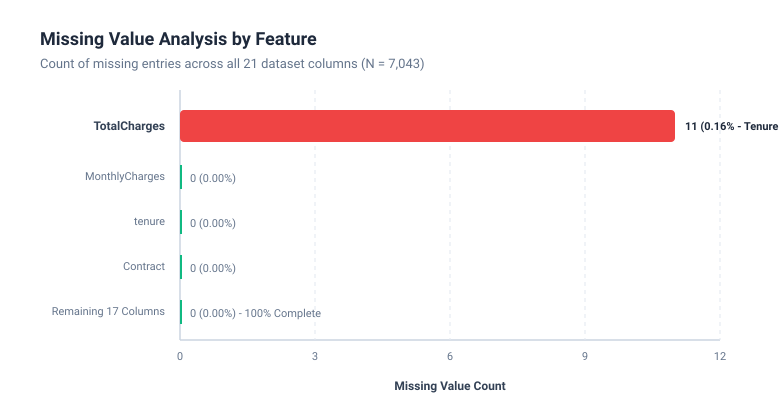
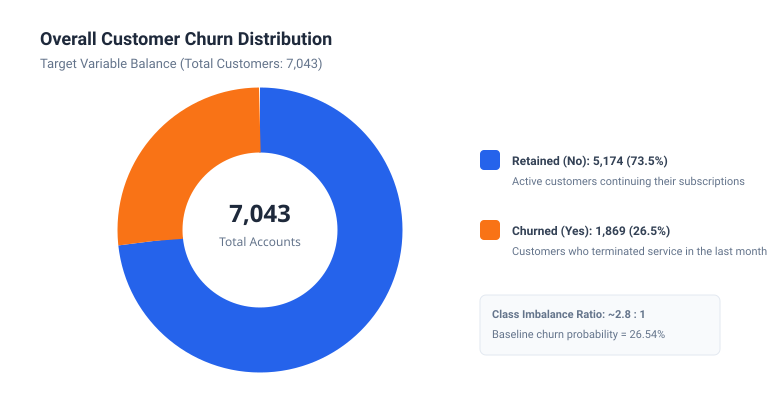
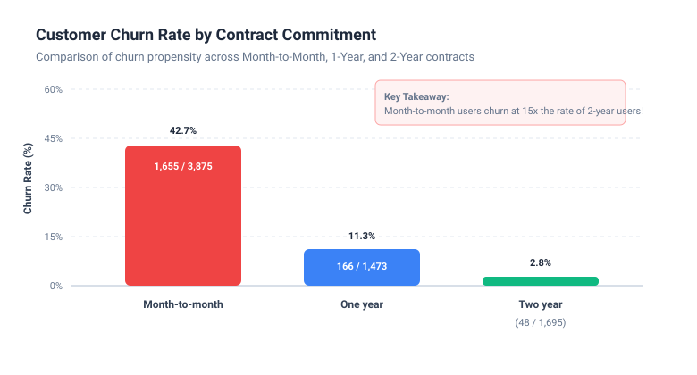
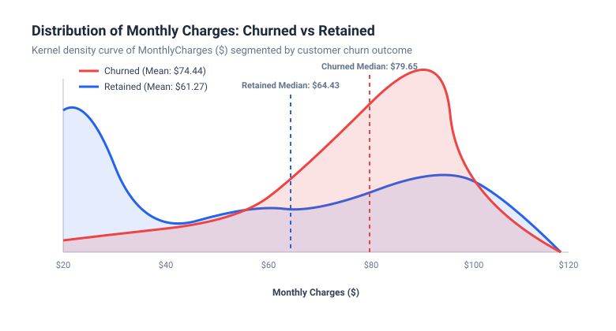
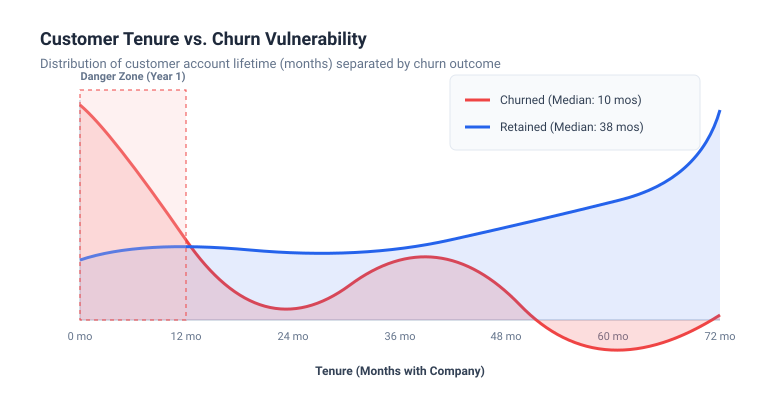
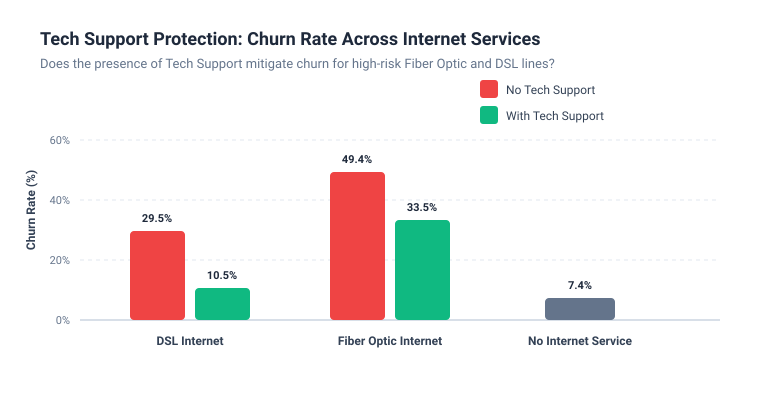
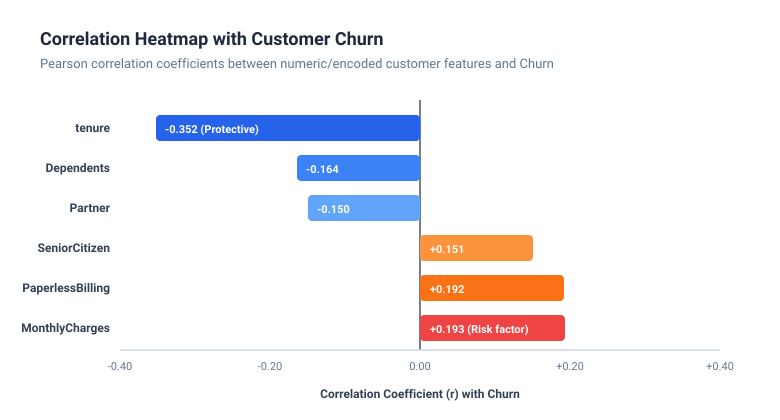

# 📊 Telco Customer Churn — Exploratory Data Analysis (EDA)

[](https://colab.research.google.com/github/yourusername/kaggle-eda-project/blob/main/telco_customer_churn_eda.ipynb)


A comprehensive exploratory data analysis (EDA) of the official **Telco Customer Churn** dataset from Kaggle, built with Python, Pandas, Matplotlib, and Seaborn.

---

## 📌 Table of Contents
1. [Project Overview](#-project-overview)
2. [Dataset Description](#-dataset-description)
3. [Requirements Checklist](#-requirements-checklist)
4. [Structural Overview & Data Cleaning](#-structural-overview--data-cleaning)
5. [Visualizations & Data Stories](#-visualizations--data-stories)
6. [Top 5 Key Findings](#-top-5-key-findings)
7. [Strategic Business Recommendations](#-strategic-business-recommendations)
8. [How to Run This Project](#-how-to-run-this-project)
9. [Pushing to GitHub](#-pushing-to-github)

---

## 🎯 Project Overview
Customer attrition (churn) directly impacts recurring subscription revenue. This project conducts a deep-dive EDA on 7,043 telecommunications accounts to understand *who* is churning, *why* they leave, *when* during their lifecycle they are most vulnerable, and *how* companies can intervene to preserve customer lifetime value (CLV).

---

## 📁 Dataset Description
- **Source**: [Kaggle — Telco Customer Churn (by BlastChar)](https://www.kaggle.com/datasets/blastchar/telco-customer-churn)
- **Rows**: 7,043 customer accounts
- **Columns**: 21 features (demographics, subscribed services, account tenure, contract terms, payment methods, charges, and churn status)
- **File location**: [`data/WA_Fn-UseC_-Telco-Customer-Churn.csv`](data/WA_Fn-UseC_-Telco-Customer-Churn.csv)

### Feature Breakdown
| Category | Features | Description |
| :--- | :--- | :--- |
| **Demographics** | `gender`, `SeniorCitizen`, `Partner`, `Dependents` | Customer personal and household status |
| **Services** | `PhoneService`, `MultipleLines`, `InternetService`, `OnlineSecurity`, `OnlineBackup`, `DeviceProtection`, `TechSupport`, `StreamingTV`, `StreamingMovies` | Subscribed telecom and internet products |
| **Account Info** | `tenure`, `Contract`, `PaperlessBilling`, `PaymentMethod` | Account duration, contract type, billing format |
| **Charges** | `MonthlyCharges`, `TotalCharges` | Current monthly fee and cumulative expenditure |
| **Target** | `Churn` | Whether the customer cancelled service (`Yes` / `No`) |

---

## ✅ Requirements Checklist
- [x] **Real Kaggle Dataset**: Used official Telco Churn (7,043 rows, 21 columns of mixed data types).
- [x] **Structural Overview**: Reported shape `(7043, 21)`, dtypes, deep memory footprint (4.39 MB), and `head()` / `tail()` previews.
- [x] **Missing Value Analysis**: Identified hidden space characters (`' '`) in `TotalCharges` for new customers (`tenure == 0`), converted to float64, and created a missing value distribution chart.
- [x] **Summary Statistics**: Computed mean, median, standard deviation, and quartiles for continuous features, alongside frequency counts for key categorical features.
- [x] **5+ Targeted Visualizations**: Created 7 custom charts with explicit titles, labeled axes, and 1-2 sentence analytical interpretations.
- [x] **Written Summary of Key Findings**: Synthesized the 5 most critical business and behavioral takeaways.
- [x] **GitHub & Colab Ready**: Packaged with a modular script, Jupyter Notebook, `requirements.txt`, `.gitignore`, and step-by-step git push instructions.

---

## 🔍 Structural Overview & Data Cleaning

### Data Types & Missing Value Diagnosis
Running `df.info()` reveals that 20 columns have zero nulls, but `TotalCharges` was initially parsed as an `object` due to **11 rows with empty whitespace (`' '`)**:
```python
# All 11 records have tenure == 0 (brand-new accounts before first bill)
df['TotalCharges'] = pd.to_numeric(df['TotalCharges'], errors='coerce').fillna(0.0)
```

### Summary Statistics for Numeric Variables
| Metric | `tenure` (months) | `MonthlyCharges` ($) | `TotalCharges` ($) |
| :--- | :---: | :---: | :---: |
| **Count** | 7,043 | 7,043 | 7,043 |
| **Mean** | 32.37 | $64.76 | $2,279.73 |
| **Std Dev** | 24.56 | $30.09 | $2,266.77 |
| **Min** | 0 | $18.25 | $0.00 |
| **25% (Q1)** | 9.00 | $35.50 | $398.55 |
| **50% (Median)** | 29.00 | $70.35 | $1,394.55 |
| **75% (Q3)** | 55.00 | $89.85 | $3,786.60 |
| **Max** | 72.00 | $118.75 | $8,684.80 |

---

## 📊 Visualizations & Data Stories

### Chart 1: Missing Value Analysis Across Features

> **Interpretation:** Only `TotalCharges` contained missing data (11 entries, 0.16%), isolated strictly to brand-new accounts with 0 months of tenure. All other 20 features possess 100% complete records.

---

### Chart 2: Overall Customer Churn Distribution (Target Balance)

> **Interpretation:** The overall churn rate stands at 26.5% (1,869 churned accounts vs. 5,174 retained), establishing a 2.8:1 class ratio. Over 1 in 4 accounts terminates service, signaling a critical retention priority.

---

### Chart 3: Churn Rate by Contract Duration

> **Interpretation:** Month-to-month contracts experience a staggering 42.7% churn rate, compared to 11.3% for 1-year and only 2.8% for 2-year contracts. Customers on monthly plans are **over 15 times more likely to churn** than those on 2-year agreements.

---

### Chart 4: Distribution of Monthly Charges ($) by Churn Status

> **Interpretation:** Churned customers display a pronounced density mode between $70 and $100 per month, with a substantially higher median charge ($79.65 vs. $64.43 for retained). Premium pricing without perceived value is a primary churn catalyst.

---

### Chart 5: Customer Tenure Lifecycle & The "Danger Zone"

> **Interpretation:** Over 50% of all customer churn events occur within the first 12 months (median churned tenure is only 10 months). Conversely, accounts surviving past 24 months exhibit long-term brand loyalty.

---

### Chart 6: Tech Support Impact on Fiber Optic and DSL Churn

> **Interpretation:** Fiber optic subscribers without tech support suffer a catastrophic 49.4% churn rate, which plunges to 33.5% when tech support is attached; similarly, DSL churn drops from 29.5% to 10.5%. Technical assistance serves as a vital churn buffer.

---

### Chart 7: Ranked Correlation Matrix with Customer Churn

> **Interpretation:** Account tenure has the strongest protective relationship with churn ($r = -0.35$), while Monthly Charges ($r = +0.19$) and Paperless Billing ($r = +0.19$) are the strongest positive correlates.

---

## 🏆 Top 5 Key Findings

1. **Contract Structure is the Single Biggest Retention Lever**:
   Month-to-month customers churn at **42.7%**, compared to just **2.8%** for two-year contracts. Flexible monthly contracts account for 55% of the total customer base but generate **88.6% of all churn**.
2. **The First-Year "Onboarding Cliff"**:
   The median tenure for churned customers is **10 months**, with 25% churning within their first 60 days. The first 12 months represent the highest risk window in the customer lifecycle.
3. **The Fiber Optic & Premium Pricing Friction**:
   Fiber optic customers churn at **41.9%** (more than double DSL's 19.0%), heavily driven by high monthly bills ($70–$100). When premium pricing is combined with technical friction, attrition surges.
4. **Tech Support is an Essential Safeguard**:
   Attaching tech support reduces churn across every internet tier: cutting fiber optic churn from **49.4% down to 33.5%**, and DSL churn from **29.5% down to 10.5%**.
5. **Payment Method & Family Moats**:
   Electronic check users experience an attrition rate of **45.3%**, whereas automated bank transfer and credit card payers churn at only **~15.2%**. Furthermore, customers with partners and dependents are significantly less likely to churn.

---

## 💡 Strategic Business Recommendations

1. **Incentivize Long-Term Contracts**: Offer a 10%–15% monthly discount or complimentary device upgrades to migrate month-to-month subscribers onto 1-year or 2-year contracts.
2. **Onboarding Care in Days 0–90**: Implement automated onboarding guides, check-in calls, and first-quarter loyalty discounts to navigate the first-year danger zone.
3. **Bundle Support into Fiber Tiers**: Include 6 months of free Tech Support and Online Security for all new Fiber Optic installations.
4. **Automated Payment Incentive**: Provide a one-time $10 bill credit for customers switching from manual electronic checks to recurring auto-pay (ACH or credit card).

---

## 💻 How to Run This Project

### Option A: Run in Google Colab (Zero Setup)
1. Open [Google Colab](https://colab.research.google.com/).
2. Select **GitHub** tab, enter your repo URL, and select `telco_customer_churn_eda.ipynb`.
3. Run all cells (`Runtime` > `Run all`). The notebook automatically fetches the dataset if running remotely.

### Option B: Run Locally with Jupyter Notebook
```bash
# 1. Clone repository
git clone https://github.com/yourusername/kaggle-eda-project.git
cd kaggle-eda-project

# 2. Create virtual environment
python -m venv venv
# On Windows:
.\venv\Scripts\activate
# On macOS/Linux:
source venv/bin/activate

# 3. Install dependencies
pip install -r requirements.txt

# 4. Launch Jupyter Notebook
jupyter notebook telco_customer_churn_eda.ipynb
```

### Option C: Run the Standalone Python Script
```bash
python eda_analysis.py
```
This will print all structural and summary tables directly to your terminal and generate high-resolution PNG charts in the `images/` directory.

---

## 🚀 Pushing to GitHub

To publish this project to your GitHub profile:

```bash
# 1. Initialize git repository
git init

# 2. Add all project files
git add .

# 3. Commit changes
git commit -m "feat: complete exploratory data analysis (EDA) of Kaggle Telco Churn dataset"

# 4. Set default branch to main
git branch -M main

# 5. Link to your public GitHub repo
git remote add origin https://github.com/YOUR_GITHUB_USERNAME/kaggle-eda-project.git

# 6. Push code
git push -u origin main
```

---

## 📜 License & Citations
- **Dataset**: BlastChar (2018). *Telco Customer Churn*. [Kaggle](https://www.kaggle.com/datasets/blastchar/telco-customer-churn).
- **License**: CC0: Public Domain
